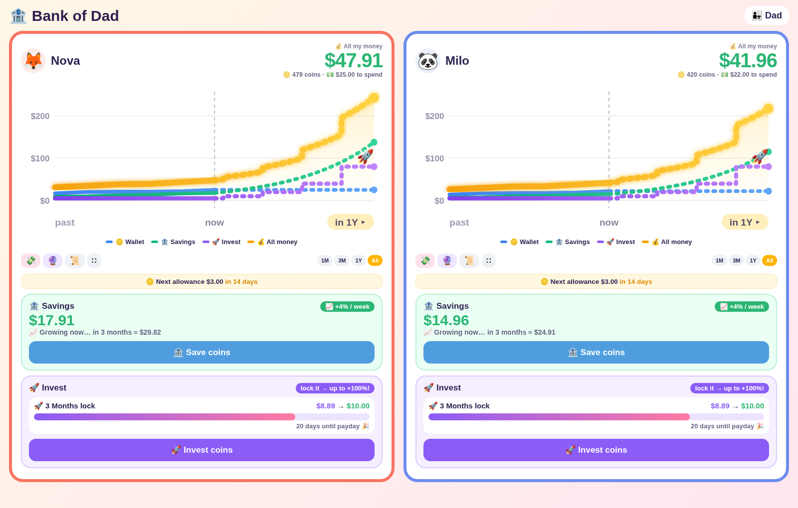

# Bank of Dad

A local, kid-friendly savings dashboard for tracking imaginary family balances, allowances, savings interest, and fixed-term investments. It does not connect to a bank or move real money.

## Screenshots

These screenshots show fictional names and sample balances in a disposable database. A fresh install starts empty.

**Dashboard** — see balances, projected growth, savings, and investments at a glance.



**Money over time** — explore an expanded view of past and projected balances.


## Start

Requires Python 3 and `venv`. From this directory:

```sh
./run.sh
```

The script creates a local virtual environment, installs Flask, and starts the app. Open **http://127.0.0.1:5001** on the same machine. On first visit, set a 4–8 digit Dad PIN, open **Dad**, and add a kid by name and emoji. A fresh database starts empty; no example family or transaction history is included. Newly added kids receive the starting wallet amount configured in `config.py`.

Use Dad controls to adjust allowances and rates, give money, edit transactions, or advance the clock for demonstrations. Kids can collect rewards, save, withdraw, invest, and record spending. Changes persist in SQLite. This is an educational simulation; rates and balances are not financial advice or actual accounts.

Savings interest accrues lazily. A successful savings deposit or withdrawal folds the rounded accrued interest into savings and resets the accrual clock. When that interest is positive, the transaction list records a separate positive `interest` entry labeled “Savings interest” alongside the move, just as it does when interest is collected as a reward. Zero or negative accrued amounts produce no interest entry; existing balance calculations are unchanged. A rejected move does not collect interest. Requests exceeding available funds are capped to the available balance, as before. The balance, entries and history snapshot are committed together. Older moves that capitalized interest without an entry are not backfilled; their past transaction history may not fully explain the balance.

## Transaction and adapter contract

All bank mutation helpers, including rates, kids, PIN and clock controls, acquire SQLite's database-wide writer lock before reading and commit their changes together when they own the transaction. If a connection is already in a transaction, the helper uses a savepoint and never commits the caller's work; the caller must commit or roll it back. This changes the administrative helpers' previous unconditional-commit behavior. SQLite itself can abort an entire transaction on severe errors or a `RAISE(ROLLBACK)` trigger, which no savepoint can prevent. A deferred transaction with an obsolete WAL snapshot cannot be upgraded and fails with SQLite's busy/snapshot error: roll back and retry the *whole outer transaction*, not just the action. A long-lived caller transaction holds its writer lock until it ends.

Overlapping bank mutations on the same connection from different threads fail with `RuntimeError`; same-thread nested helpers are supported. Use separate connections for concurrent work. The guard covers bank mutation helpers only: callers must exclusively own a connection for the entire caller-managed transaction, including between helper calls, and must not concurrently use raw SQL, `db.set_setting`, read helpers, commit, rollback, or close on that connection. Those operations bypass the guard. `db.set_setting` is a low-level uncommitted primitive; `db.init_db` creates and owns its separate initialization connection. HTTP admin PIN checks occur separately from subsequent actions, so a concurrent PIN change does not atomically revoke an already-authorized request.

This protocol requires a real `sqlite3.Connection` (subclasses are supported), transaction state, `BEGIN IMMEDIATE`, savepoints, and SQLite-compatible writer locking. Other connection adapters are rejected before any action SQL. A hosted Durable Object SQL adapter must provide equivalent atomic outer transactions, nested rollback and serialized writer-before-read behavior, and correctly report transaction state; unsupported transaction statements must raise, never silently become no-ops. Adapt and test the hosted integration separately before using these root sources there. A no-op commit or transaction statement is not sufficient, and hosted compatibility has not been verified here.

## Configuration and data

| Variable | Default | Meaning |
| --- | --- | --- |
| `BANK_OF_DAD_HOST` | `127.0.0.1` | Listen address |
| `BANK_OF_DAD_PORT` | `5001` | Listen port |
| `BANK_OF_DAD_DB` | `data/bank.db` in this directory | SQLite database path |

For example, `BANK_OF_DAD_PORT=5005 ./run.sh`. Back up your database separately; it contains children's names, balances, history and the PIN hash. Never commit it, local environment files, or backups to a public repository. The app creates the database directory when needed. Configure rules in `config.py` or use the Dad panel for per-child allowances and rates.

## Security limitations

**Localhost is the safe default. Do not expose this app to the public internet or an untrusted network.** The built-in Flask server is for local use, not a production deployment. The PIN is a child deterrent, not secure authentication: it has a small search space, no rate limiting, and is sent in requests without encryption over HTTP. Before the first PIN is set, administrative API access is not protected; set it immediately on a trusted machine. The kid-facing API is intentionally unauthenticated, and anyone with access can view or modify some data. Network access requires your own strong authentication, transport encryption, network isolation, and security review. No payment or banking integration is provided.

## Tests

```sh
python3 -m venv .venv
.venv/bin/pip install -r requirements.txt
.venv/bin/python -m unittest discover -s tests -v
```

Tests use temporary databases; set `BANK_OF_DAD_DB` to a disposable path when running any additional experiments because importing `app` initializes the configured database.

## Licensing

Bank of Dad is available under the [MIT License](LICENSE).
