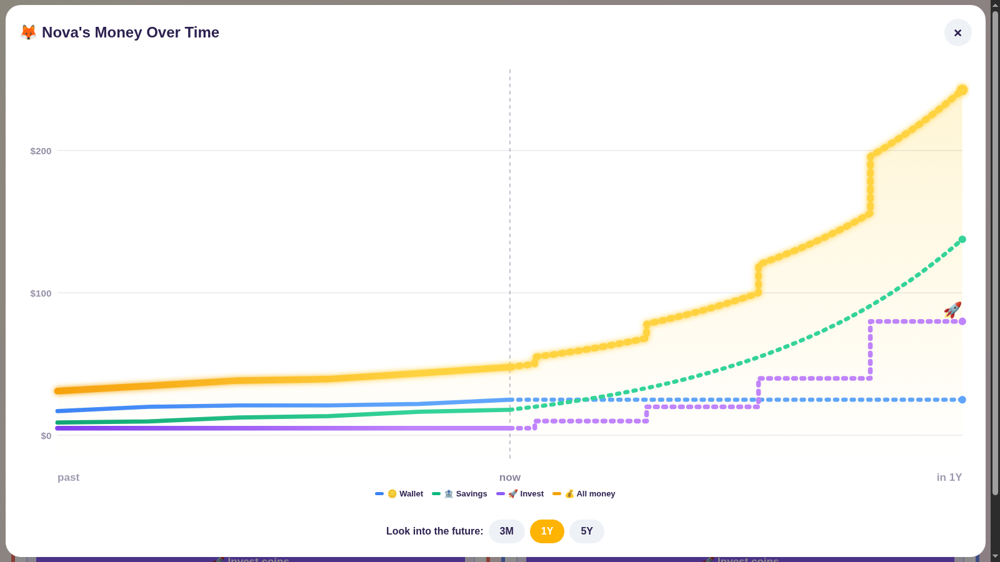

# Bank of Dad

A local, kid-friendly savings dashboard for tracking imaginary family balances, allowances, savings interest, and fixed-term investments. It does not connect to a bank or move real money.

## Screenshots

These screenshots show fictional names and sample balances in a disposable database. A fresh install starts empty.

**Dashboard** — see balances, projected growth, savings, and investments at a glance.


**Money over time** — explore an expanded view of past and projected balances.



## Start

Requires Python 3 and `venv`. From this directory:

```sh
./run.sh
```

The script creates a local virtual environment, installs Flask, and starts the app. Open **http://127.0.0.1:5001** on the same machine. On first visit, set a 4–8 digit Dad PIN, open **Dad**, and add a kid by name and emoji. A fresh database starts empty; no example family or transaction history is included. Newly added kids receive the starting wallet amount configured in `config.py`.

Use Dad controls to adjust allowances and rates, give money, edit transactions, or advance the clock for demonstrations. Kids can collect rewards, save, withdraw, invest, and record spending. Changes persist in SQLite. This is an educational simulation; rates and balances are not financial advice or actual accounts.

## Configuration and data

| Variable | Default | Meaning |
| --- | --- | --- |
| `BANK_OF_DAD_HOST` | `127.0.0.1` | Listen address |
| `BANK_OF_DAD_PORT` | `5001` | Listen port |
| `BANK_OF_DAD_DB` | `data/bank.db` in this directory | SQLite database path |

For example, `BANK_OF_DAD_PORT=5005 ./run.sh`. The app creates the database directory when needed. Configure rules in `config.py` or use the Dad panel for per-child allowances and rates.

## Local backup and restore

Make regular backups to a private location outside the repository. A backup contains private family data, including children's names, balances, history, and the PIN hash. **Never commit or publicly share a database or backup**, even if its filename is not ignored by Git. Restrict access, encrypt backups where appropriate, and retain multiple dated copies in a separate safe location.

Use Python 3 on the machine with the database; specify both the existing database and a **new** output path (the output directory must already exist):

```sh
python3 tools/backup_local.py /path/to/data/bank.db /private/backups/bank-2026-01-01.db
```

The source is the path configured by `BANK_OF_DAD_DB`, or `data/bank.db` in this directory by default. The tool uses SQLite's online backup API for a consistent snapshot, including committed WAL data, without making logical changes to the source database. SQLite opens the source read-only, but may create, update, or remove `-wal` and `-shm` sidecars and may need directory permissions to do so; read-only does **not** mean byte-for-byte filesystem immutability. The tool checks snapshot integrity and rejects the source's `-wal`, `-shm`, and `-journal` names as destinations, including resolved path aliases.

On tested POSIX systems the tool creates a temporary directory with mode 0700 and a backup with mode 0600, then publishes with an atomic hard link that fails if the final name already exists (including a symlink). The output filesystem must support hard links and the relevant POSIX directory-descriptor operations. No overwrite guarantee covers later changes by other processes; this is not a durability guarantee against a crash or power loss. A crash or forced termination may leave a private `.bod-backup-*` directory; remove it when no backup is running.

**Use trusted source and output directories and trusted ancestors**, protected against other users changing, renaming, or replacing path components for the duration of the backup. In particular, 0700 does not prevent someone who can write a non-sticky parent directory from renaming the temporary directory and substituting another path; directory descriptors for publication do not secure SQLite's earlier path-based opens. Same-user processes, privileged users, ACLs, unusual filesystems, other operating systems and hostile namespace changes are outside the tested security boundary. Verify permissions and filesystem behavior in your environment. This exports a full SQLite database, not a sanitized or encrypted export.

To restore, **stop the service and all other database clients first**. Preserve the existing database and its `-wal` and `-shm` sidecars in a separate safe location before changing anything. Copy the chosen backup to the configured database path with owner-only permissions, making sure old sidecars are not left beside the restored database, then start the service and check the data. Do not overwrite your only backup. Store and periodically test multiple backups; an integrity check does not prove that a backup contains the data or point in time you intended.

## Security limitations

**Localhost is the safe default. Do not expose this app to the public internet or an untrusted network.** The built-in Flask server is for local use, not a production deployment. The PIN is a child deterrent, not secure authentication: it has a small search space, no rate limiting, and is sent in requests without encryption over HTTP. Before the first PIN is set, administrative API access is not protected; set it immediately on a trusted machine. The kid-facing API is intentionally unauthenticated, and anyone with access can view or modify some data. Network access requires your own strong authentication, transport encryption, network isolation, and security review. No payment or banking integration is provided.

## Tests

```sh
python3 -m venv .venv
.venv/bin/pip install -r requirements.txt
.venv/bin/python -m unittest discover -s tests -v
```

Tests use temporary databases; set `BANK_OF_DAD_DB` to a disposable path when running any additional experiments because importing `app` initializes the configured database.

## Licensing

Bank of Dad is available under the [MIT License](LICENSE).
